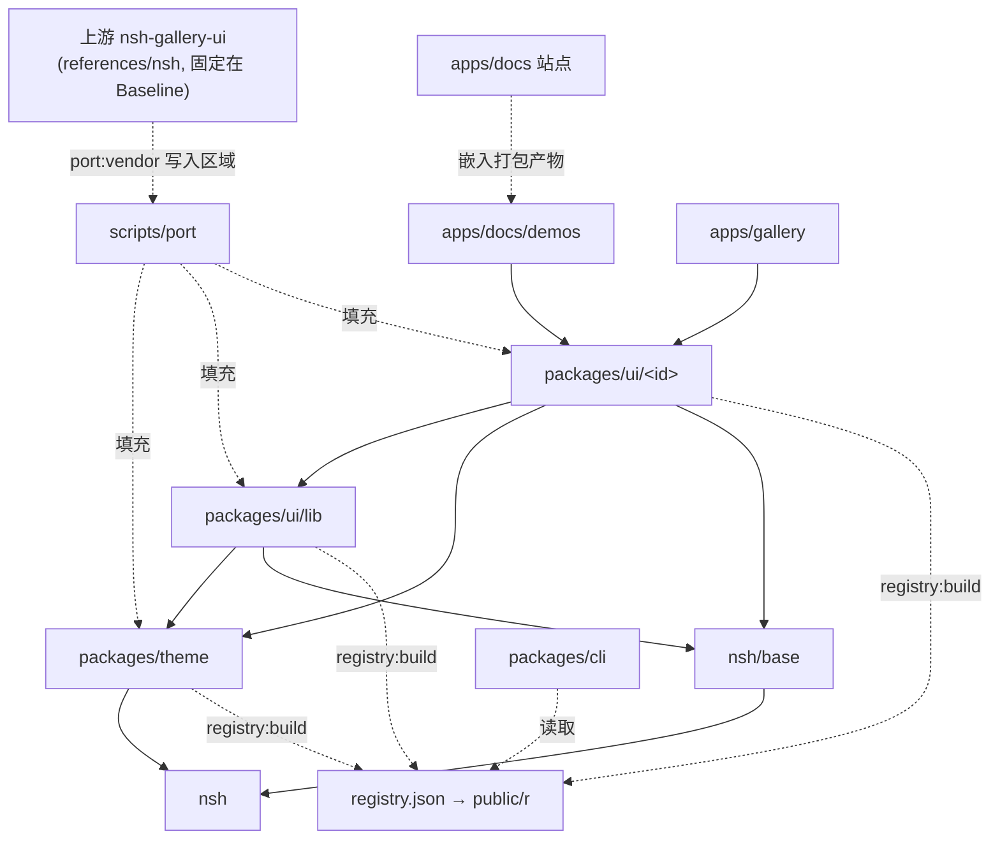

# shadcn-nsh Architecture

把**上游**（`references/nsh/examples/nsh-gallery-ui`）的外观搬进一个文件一个**组件**，经 registry 与 CLI 以 **Copy-into-app** 交付。外观来自上游，行为来自 `nsh/base`，分发与组合角色来自 shadcn。词汇见 [`GLOSSARY.md`](GLOSSARY.md)。

## Stack

**运行时与组件**：NSH（`nsh`、`nsh/base`），CLI 安装、从不编译；版本等于 **Baseline**（见 [`toolchain.md`](toolchain.md)）
_Avoid_: 编译 NSH、设 `NSH_RUNTIME`、自定 primitive 层

**脚本与依赖**：Bun；格式化、lint、工具面类型用 Vite+（`vp`），配置只在根 `vite.config.ts`
_Avoid_: Prettier、npm / pnpm 脚本

**上游解析**：`oxc-parser`
_Avoid_: TypeScript 编译器 API、正则切声明

**文档站**：Astro（`apps/docs`），演示由 `nsh package --target web` 打包后嵌入

**分发**：shadcn registry 格式（`registry.json` → `public/r`）+ 本仓 CLI `shadcn-nsh`
_Avoid_: 发布组件 npm 包、旧 registry id 的别名

**许可**：移植内容保持上游的 Apache-2.0，文件头与 `NOTICE` 注明来源

## Layout

- `port-map.json`：**Port Map**，上游每个声明的唯一去向表；组件清单由它与 `registry.json` 生成，不手写
- `packages/theme/`：**Theme Source**（两个 JSON 原样拷贝）与 `theme.ts`（脚本填充）；不放组件
- `packages/ui/<id>.tsx`：一个**组件** = **Port Region** + **Shell**；一个 registry 条目一个文件
- `packages/ui/lib/`：没有所属控件的上游部分（以上游文件名命名）与多个外壳共用的接线；作为 `registry:lib` 条目分发
- `apps/docs/demos/`：每个组件的 `<id>.tsx` 与 **Reference Page** `<id>.ref.tsx`、渲染比对用例与基线截图；`kit.tsx` 是演示外框，不进 registry
- `apps/docs/src/pages/docs/components/<id>.md`：组件文档页，固定四节
- `apps/gallery/`：原生行为测试与冒烟页，用同一套 `packages/ui`；不做公开文档，不比截图
- `packages/cli/`：`shadcn-nsh` CLI（`init`、`add`、`list`、`view`、`diff`、`build`、`serve`）
- `scripts/port/`：搬运与核对工具；唯一读 `references/nsh` 的代码
- `references/`：只读子模块

## Layers

- `packages/ui/lib` 不 import `packages/ui/<id>`；组件之间可以 import（`./button`），依赖写进该条目的 `registryDependencies`
- `packages/theme` 不 import `packages/ui`
- `packages/*` 不 import `apps/*`、`scripts/*` 或 `references/*`；运行时代码只认 `@shadcn-nsh/theme`、`nsh`、`nsh/base` 与相对路径
- 只有 `scripts/port` 读 `references/nsh`；`apps/docs` 的构建不需要子模块

## Rules

每条规则都有脚本判定；没有判定的不写进来。判定与命令见 [`port.md`](port.md#检查)。

| #   | 规则                                                                                                                |
| --- | ------------------------------------------------------------------------------------------------------------------- |
| P1  | **清单唯一。** 上游每个文件、每个顶层声明在 Port Map 里有去向，或是带理由的 `exclude`                               |
| P2  | **上游代码只由脚本写入。** 它只出现在 Port Region 里；要改，改 Baseline 或 Port Map                                 |
| P3  | **偏离上游必须登记。** 文字与上游不同的声明写进 `replace`，带 `why`                                                 |
| P4  | **外壳不改变渲染。** 组件页与它的 Reference Page 截图相同（指针与触屏，亮与暗）；没有外壳的组件声明 `selfReference` |
| P5  | **外壳不缩减能力。** 组件 props 是对应 `nsh/base` props 加自己的轴；样式类 props 叠在 look 之上，使用者优先         |
| P6  | **依赖如实。** registry 条目的依赖等于实际 import，相对 import 的文件必须有条目分发                                 |
| P7  | **外壳里没有外观。** Port Region 之外不出现颜色字面量                                                               |

**归属**（一个上游声明去哪个文件）：

1. 描述某个控件的 look，进该控件的组件文件；别的组件需要时 import 那个组件
2. 上游一个文件服务多个控件时，按声明拆到各自的组件；文件私有的常量可以路由到多个目标
3. 没有所属控件的，进 `packages/ui/lib/<上游文件名>`
4. 主题相关的进 `packages/theme`

**外观随外观模式变化**：颜色与依赖 props 的 look 在 JSX 里读，不在组件体里读一次存下（web 上是 CSS 变量看不出来，原生上会冻结）。

## Seams

**Registry**（`registry.json` 的 shadcn 格式）：CLI 只经它拿组件，不读仓库源码
_Adapters_: GitHub Pages 上的 `public/r`、本地 `registry:serve`、CLI 测试的夹具 registry

**渲染用例表**（`apps/docs/demos/render-cases.ts`）：哪些页、怎么定身、怎么比较，只在这里定义
_Adapters_: web 指针（`port:render`）、iOS 触屏（`port:render:touch`）、外观切换检查
