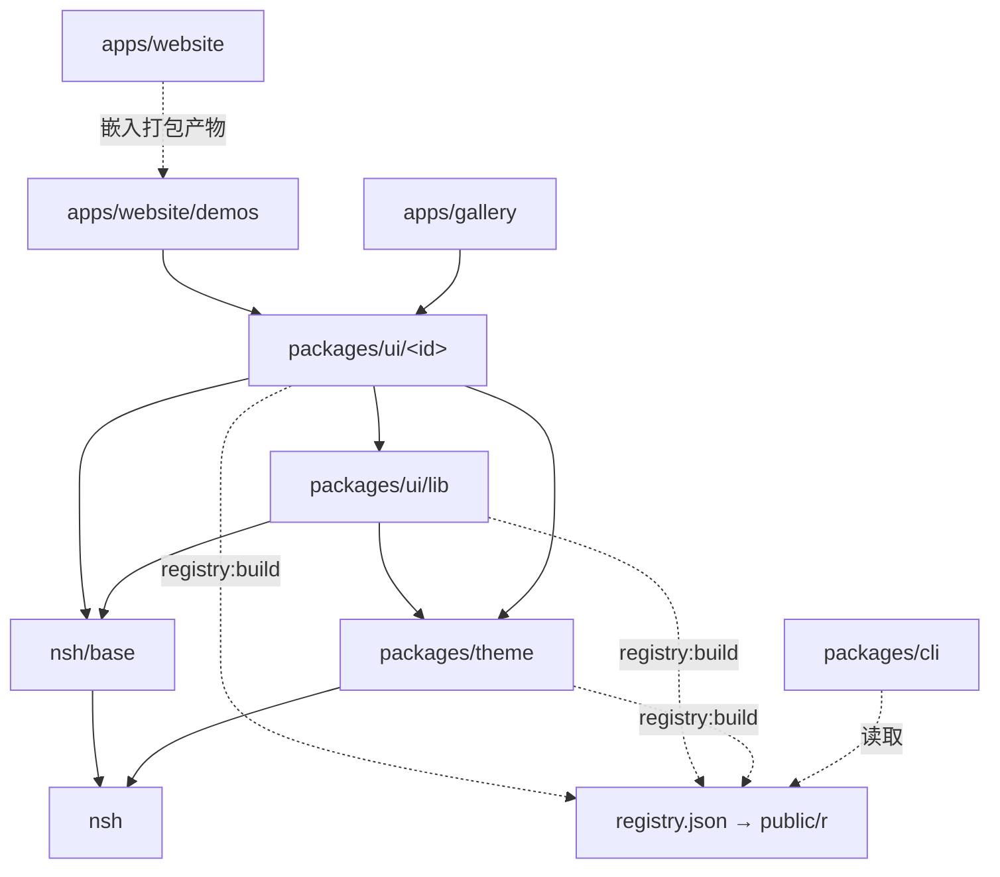

# shadcn-nsh Architecture

一个文件一个**组件**，经 registry 与 CLI 以 **Copy-into-app** 交付。复制进应用后归应用所有。外观、状态、几何和对外 API 由本库决定；行为与无障碍来自 `nsh/base`（不改）；分发、目录、组合角色（`Trigger` / `Content` / `Item`）与 API 命名参照 shadcn。词汇在文末。组件怎么写见 [`component-authoring.md`](component-authoring.md)，主题见 [`theme.md`](theme.md)。

## Stack

**运行时与组件**：NSH（`nsh`、`nsh/base`）。CLI 只安装、不编译。版本见根 `package.json` 的 `engines.nsh`。
_Avoid_: 编译 NSH、设 `NSH_RUNTIME`、自定 primitive 层

**脚本与依赖**：Bun。格式化、lint、工具面类型用 Vite+（`vp`），配置只在根 `vite.config.ts`。
_Avoid_: Prettier、npm / pnpm 脚本

**文档站**：TanStack Start + Fumadocs（`apps/website`），静态预渲染。演示由 `nsh package --target web` 打包后嵌进 iframe。

**分发**：两条路。Copy-into-app 走 shadcn registry（`registry.json` → `public/r`）和 CLI `shadcn-nsh`。TSX `nshm` 走根目录 `nsh.json`（`nsh add github:aningdev/shadcn-nsh`），零 npm 依赖。
_Avoid_: 把组件做成 npm 包、为旧 registry id 留别名

**许可**：MIT。改编自 NSH 的文件保持 Apache-2.0，文件头致谢行与根目录 `NOTICE` 注明来源。

## Layout

- `registry.json`：组件集合的真源。`registry:ui` 条目就是组件。
- `packages/theme/`：六套主题（`nsh-gallery`、`shadcn`、`solid-glass`、`apple`、`material`、`winui`）。真源是 `themes/<id>/index.ts`：`nsh-gallery` 为完整 `base`，其余 `defineTheme()` 稀疏覆写。`bun run theme:build` 单向导出 `theme.json`、W3C DTCG `{light,dark}.tokens.json` 与 `DESIGN.md`（生成，不手改）。运行时经 `theme.ts` 读 `AppTheme`（`selectTheme` / `currentTheme`）。`themes/native` 的 `nativeTheme()` 按 `platform.os` 选平台主题。契约见 [`theme.md`](theme.md)。
- `packages/ui/<id>.tsx`：一个组件 = 私有 Look + 外壳，一个 registry 条目一个文件。起源于 NSH gallery 的文件在文件头一行致谢，代码归本库。
- `packages/ui/lib/`：没有所属控件、且至少两个组件复用的原语（`utils`、`state`、`motion`、`surface`、`field-look`、`choice`、`icons`、`popup`、`listbox`），作为 `registry:lib` 分发。只被一个控件用的收回该控件。
- `apps/website/demos/`：每个组件一份 `<id>.tsx`。`kit.tsx` 是页面外框，`stage.tsx` 是演示适配层（`Stage` / `Split` / `Inspector` / `Panel` / `Log` / `Segmented` / `Chips`）。`photos.ts` 等数据只供演示，不进 registry。窄屏截图在 `shots/narrow/`，不提交。
- `apps/website/content/docs/`：文档页。组件页章节见 [`component-authoring.md`](component-authoring.md#文档页)。`official.ts` 登记 shadcn/ui 与 NSH 元素的来源、去向和没做的理由；`kinds.ts` 由此推出 Base / Enhanced。生成的行不手写。
- `apps/website/public/demos/`：`docs:demos` 的打包产物，不进仓库。`player-options.ts` 让页面认面板的 `?idiom=` / `?theme=`。
- `apps/showcase/`：展示应用。壳与场景用 `packages/ui` 重建，`nsh test apps/showcase` 测壳，首页 “See it running” 嵌入其打包产物。
- `apps/gallery/`：原生行为测试与冒烟，不比截图。
- `packages/cli/`：`init`、`add`、`list`、`view`、`diff`、`build`、`serve`。
- 根 `nsh.json`：TSX `nshm` 清单。`version` 与 `packages/cli/package.json` 相同，`bun run catalog` 按 CLI 版本重写它。`exports` 覆盖 `shadcn-nsh`、主题和每个 `registry:ui` 组件。
- `scripts/registry/catalog.ts`：读写 `registry.json` 的唯一入口，并生成 `catalog.generated.ts` 与根 `nsh.json`（不手改）。
- `scripts/` 按职能分四层：`lint/`（UI 静态检查与演示覆盖）、`theme/`（主题构建、对比度、不变量、语义表与 diff）、`registry/`（目录、构建与安装端到端）、`scaffold/`（新组件脚手架与模板）。

## Layers

- `lib` 不 import 组件；组件之间可以 import，依赖写进该条目的 `registryDependencies`（`check:ui`）。
- `packages/theme` 不 import `packages/ui`。组件经 `../theme` 取外观（`lib/` 经 `../../theme`），不直接读 `theme.json` 或 `themes/<name>/`。CLI `add` 把这两条相对路径重写成消费方的 theme alias。
- `packages/*` 不 import `apps/*` 或 `scripts/*`。`packages/ui` 运行时代码只认相对路径、`nsh` 和 `nsh/base`。基础图标在 `packages/ui/lib/icons.tsx`（39 个与 lucide `IconNode` 同结构的节点）。应用仍可把 `lucide` 的图标传进来。
- 组件集合只从 `scripts/registry/catalog.ts` 或 `catalog.generated.ts` 取。`packages/ui/index.ts` 手写导出，`catalog --check` 保证它覆盖每个组件。
- registry JSON 的形状只在 `packages/cli/src/utils/registry-schema.ts` 校验。`scripts/*` 可以把 `packages/cli/src/*` 当库 import。

## Themes

| 词             | 是什么                                                   | 谁定                                                                |
| -------------- | -------------------------------------------------------- | ------------------------------------------------------------------- |
| **构建时主题** | `nsh.json` 指向的 `theme.json`，以及 `init` 装上的读取层 | `init --theme <name>`（记在 `nsh-ui.json`）                         |
| **AppTheme**   | `{ id, label, theme, spec }`                             | `theme-<name>` 条目；`add theme-<name>` 多装一套到 `themes/<name>/` |

`selectTheme(theme)` 换一整套，`selectTheme(null)` 回到构建时主题。圆角经 `shape.*` 与 `rounded()`，线宽读 `stroke`，字体读 `font.sans` / `font.mono`。`surface()` 与 `control()` 在 JSX 里读；存进模块级常量后，运行时切换不会跟着变。键与角色见 [`theme.md`](theme.md)。

## Rules

每条都有脚本判定。

| 规则                  | 判定                                                                                                                                                                                                                         |
| --------------------- | ---------------------------------------------------------------------------------------------------------------------------------------------------------------------------------------------------------------------------- |
| **颜色只来自主题**    | 组件、`lib` 与演示不写颜色字面量。例外在该行或上一行标 `// color: <原因>`。`ui-guards.test.ts`                                                                                                                               |
| **外壳透传 props**    | props 是对应 `nsh/base` props 加自己的轴。`props.test-d.ts`，由 `nsh check apps/website/demos` 跑                                                                                                                            |
| **registry 依赖如实** | `registryDependencies` 等于实际 import，相对 import 必须有条目分发。`registry:build`                                                                                                                                         |
| **侧向随阅读方向**    | 不对称的 left/right 用 `start`/`end`。两侧同值，或标了 `// physical: <原因>` 的，除外。`check:ui -- --only rtl`                                                                                                              |
| **不点名主题**        | 不写 `controls()`，不与主题 id 比较，不写 `fontFamily` 字面量（读 `font.sans` / `font.mono`，例外标 `// font: <原因>`）。带颜色的状态 class 标 `// state: <原因>`。自带 `class` 用 `joinClass(own, props.class)`。`check:ui` |
| **分层与导出说明**    | `lib` 不 import 组件；`packages/ui` 不 import `apps/**`、`scripts/**`，不直接读主题文件。每个导出上方有 `/** … */`。例外在 `scripts/lint/ui-rules.ts` 的 `allowlist`。`check:ui`                                             |

**`class` 与 `style`。** `style` 优先于 `class`。根节点透传 `class` 与 `classList`。布局和静态微调用 `class`；要盖过主题或跟着状态走的，用 `style`。

**children 只读一次**，读在画它的 JSX 里。门户的内容构建函数是例外，注释写 `children-lint: <原因>`。`check:ui -- --only children`。

**状态进 state 样式**（`hoverStyle`、`focusVisibleStyle`、`activeStyle`、`disabledStyle`、`selectedStyle`、`expandedStyle`、`pressedStyle` 等）。平台按变体顺序叠，后面的胜。`expanded` 与 `pressed` 排在 `hover` 与 `focus-visible` 之后；要让指针或键盘焦点盖过打开态时，打开态留在 `style` 里并写明理由。

**Credit Line** 是来源标注，不是只读区：`Derived from NSH examples/nsh-gallery-ui (Apache-2.0, © Longbridge); modified. See NOTICE.` 本库自己的组件没有这一行。

不做：改 `nsh` / `nsh/base`；在组件里写颜色字面量；把演示适配层放进组件库或 registry；为旧 registry id 提供别名。

## 词汇

**Look** 把 variant、size 与状态算成节点上的样式。默认不导出。

**Shell（外壳）** 读 props、展开 look、提供组合角色。与 look 同文件。

**Component（组件）** 一个文件：look 加外壳。以 copy-into-app 交付。

**Credit Line（致谢行）** 起源于 NSH gallery 的文件头那一行。

**Demo Adapter（演示适配层）** `Stage`、`Split`、`Inspector`、`Panel`、`Log`、`Segmented`、`Chips`，只在 `apps/website/demos/stage.tsx`。

**Variant（变体）** shadcn 的取值是 `default`、`secondary`、`outline`、`ghost`、`destructive`、`link`。本库另外这些：`tile`（radio 画成卡片）、`line`（下划线页签）、`legend` 与 `label`（字段图例）、`muted`、`icon`、`image`（item 的面与媒体）、`tinted`（bubble 的强调浅底）、`border` 与 `separator`（marker 的发丝线）、`sidebar`、`floating`、`inset`（侧栏如何贴窗口）、`highlighted`、`added`、`removed`（代码行）、`traffic-lights` 与 `caption`（窗口按钮在前缘或后缘）。`size` 用 `xs`、`sm`、`default`、`lg` 与 icon 档。`tone` 用主题的 `Tone`。
