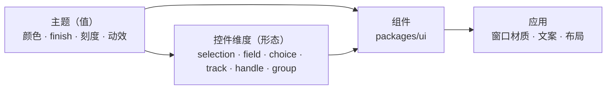

# 主题设计：做一套主题要决定什么

**读者**：要新写一套主题，或要改现有主题的人（包括编码代理）。
**读完你会知道**：一套主题要想清楚哪些设计问题；每个问题落到本库的哪个定义项、写在哪个文件、由哪项检查守住。

## 0 怎么用这篇

本篇是总览和入口，只讲“要决定什么”和“决定落在哪”，细节都链到下面这些文档，这里不重复：

| 文档                                                       | 管什么                                                                                            |
| ---------------------------------------------------------- | ------------------------------------------------------------------------------------------------- |
| [`specs/theme-roles.md`](specs/theme-roles.md)             | 每个颜色角色、每个 finish 的含义与读者；刻度例外的出处表（`theme-lint: scales`）                  |
| [`specs/theme-contract-v2.md`](specs/theme-contract-v2.md) | 当前契约的由来：原则、删除与去向、实施顺序、冻结（第 20 节）                                      |
| [`specs/design-semantics.md`](specs/design-semantics.md)   | 一个值进 `theme.json` 还是 `semantics.json` 的判定规则                                            |
| [`specs/design-tokens.md`](specs/design-tokens.md)         | DTCG 2025.10 源码的文件布局、组结构与编译                                                         |
| [`specs/native-themes.md`](specs/native-themes.md)         | Apple、Material、WinUI 三套原生主题的出处与差异                                                   |
| [`specs/semantics-values.md`](specs/semantics-values.md)   | 五套主题解析后的每一个值（颜色角色、风格组、finish、elevation）；生成表，查“这个字段各主题是什么” |
| [`GLOSSARY.md`](GLOSSARY.md)                               | 词汇                                                                                              |

- **新写一套主题**：按第 2 节从上往下决定，用第 5 节的清单逐项核对。
- **改现有主题**：先在第 5 节找到要改的那一行，看它的定义项和检查，再到第 4 节看怎么验收。

## 1 设计体系总览

- **主题**回答“这一层、这种语义长什么样”：页面是什么底色，浮层用什么面，控件多高，按下怎么变。它不回答“某个组件长什么样”。
- **控件维度**回答“一个控件怎么画自己的零件”：选中标记是胶囊、下划线还是竖条，字段是盒子、下划线还是两者，一组控件是沟槽还是格子。六个维度各选一档（第 2.12 节）。
- **组件**按层读主题：一个按钮读 `accent` finish 和 `control` 圆角，而不是读“按钮色”。
- **应用**拥有窗口和内容：窗口级材质、文案、布局都不在主题里（第 3 节）。

两条贯穿全篇的原则（[`theme-contract-v2.md`](specs/theme-contract-v2.md)）：

1. **按层与语义定角色，不按组件。** 角色名回答“哪一层、什么语义”（面、墨、边、状态、数据），不出现组件名。
2. **同类少值。** 同一类值在一套主题里是一条短刻度：高度三档、圆角三个、阴影四档、弹簧三个。加一个值之前，先看这一类已有的档能不能用。

一套设计系统要先回答的问题，就是第 2 节的 12 项：语义色组、面的层级、深度、材质、圆角、尺度与密度、字阶、线与焦点、状态、动效、控件形态，以及这套主题对齐谁（定位）。

## 2 设计一套主题要决定的事

每一节按同一结构写：**设计问题 → 定义项 → 约束 → 参照**。参照列出本库 6 套主题里有代表性的取值。

### 2.1 定位

**设计问题**：这是本库自有的风格，还是还原某个平台？和平台官方外观差多少可以接受？

**定义项**

- 主题类型：自有主题（`default`、`shadcn`、`solid-glass`）照自己的设计语言；原生主题（`apple`、`material`、`winui`）照平台官方外观。
- 出处：原生主题的每个值都能指到官方资源名（M3 的 `SurfaceContainerHigh`、WinUI 的 `ControlFillColorDefault`），写在生成器注释和主题 README 里。
- 裁剪：某个控件的官方外观个性化太强、放进契约代价太大时，原生主题可以裁剪，写进主题 README 与 [`native-themes.md`](specs/native-themes.md) 的差异表（契约原则 6）。契约冻结在 contract v3，降级并记账是它的出路：表达不了的外观改值、写进差异表，不加键、不加层。

**约束**：不为一套主题新增键、层、字段，也不在组件里写这套主题的代码或分支（[`decisions/0004`](decisions/0004-theme-contract-freeze.md)）。差异先找已有的位置：面的差异进 finish，控件形态进 `dimension.control` 的某一档；状态不是新的一层，而是 finish 上的字段。实在放不进就改值降级，并把差别写进差异表。

**参照**：`shadcn` 对齐 shadcn/ui 的 `neutral`；`solid-glass` 对齐 Solid Glass；`apple` 对齐 Apple HIG 与 Liquid Glass；`material` 对齐 Material 3 Expressive；`winui` 对齐 WinUI 3（Windows 11）。

### 2.2 颜色

**设计问题**：调色板是什么？页面分几层，每层什么色？亮暗怎么翻？墨色和底色的对比度要多少？哪些语义要单独的颜色（品牌、信息、警告、涨跌）？

**定义项**（`theme.json`，共 59 个角色）

| 层           | 内容                                                                                                                                                                                                                                              | 说明                                                                                     |
| ------------ | ------------------------------------------------------------------------------------------------------------------------------------------------------------------------------------------------------------------------------------------------- | ---------------------------------------------------------------------------------------- |
| A 层（31）   | shadcn / NSH 的槽：`background`、`foreground`、`card`、`popover`、`primary`、`secondary`、`muted`、`accent`、`destructive`、`border`、`input`、`ring`、`chart-1…5`、`sidebar-*` 及各自的 `*-foreground`                                           | 一个都不能缺：缺了 NSH 会退回 shadcn 的 neutral 灰。`sidebar-*` 写成指向本层角色的 alias |
| B 层（25）   | 面 `inset`、`raised`、`field`、`track`、`knob`；墨 `faint`、`brand`；边 `line`、`brand-edge`、`glass-edge`、`ring-halo`；状态 `hover`；数据 `info`、`warn`、`up`、`violet` 与六个 `*-tint`；反色 `inverse`、`inverse-foreground`、`inverse-brand` | 本库自己的角色，按层分组                                                                 |
| C 层（3 色） | `scrim`、`media`、`on-media`                                                                                                                                                                                                                      | 亮暗共用（同层还有 3 个圆角和两族字体，见 2.6、2.8）                                     |

**约束**

- 一个角色在每套主题里都等于某个已有角色时，删掉它，读者改读那个角色（契约原则 4）。
- 每个底色都有配套的墨色，成对可读：WCAG 2 AA，正文 4.5:1。`theme:contrast` 检查角色对（`foreground` 在 `background` / `card` / `raised` / `popover` 上，`muted-foreground` 在 `muted` 等上），以及每个 finish 用它自己的 `foreground`。达不到 AA 的值只能是平台自己的取值，要在 `contrast.ts` 里点名出处。
- 状态不能只靠颜色表达：选中、错误还要有形状、图标或文字的区别。
- 组件代码里不写颜色字面量。唯一的例外是平台固定的身份色（第 3 节）。

**参照**：`material` 的面是 M3 tonal 角色（`SurfaceContainer*`），`winui` 是填充色叠在 `SolidBackgroundFillColorBase` 上的合成值，`apple` 用系统色板，`muted-foreground` 保留 Apple 的 secondary label（低于 AA，在 `contrast.ts` 里点名）。

### 2.3 面与层次

**设计问题**：页面有几层面？卡片、凹槽、浮起的控件、浮层、对话框、反色气泡各长什么样？面上的字是什么颜色？

**定义项**：`semantics.json` 的 `finishes`，正好 14 个，11 个层加 3 种状态。

| finish                           | 画什么                                             |
| -------------------------------- | -------------------------------------------------- |
| `card`                           | 卡片、区块面                                       |
| `inset`                          | 凹进去的面：输入框、轨道、凹槽                     |
| `channel`                        | 一组选择所在的通道：分段控件的轨道                 |
| `raised`                         | 浮起的面：按钮、选择器、组合框                     |
| `plate`                          | 井里被选中的那块（上面有字）：标签页、分段的选中块 |
| `overlay`                        | 菜单、弹出框、列表浮层                             |
| `modal`                          | 对话框、抽屉                                       |
| `inverse`                        | 反色气泡：toast、tooltip                           |
| `glass`                          | 半透明的玻璃面                                     |
| `accent`                         | 强调填充：主按钮、打开的开关、进度条、选中态       |
| `knob`                           | 开关圆点、滑杆把手（不带字）                       |
| `hover` / `pressed` / `disabled` | 三种状态（2.10）                                   |

每个 finish 的字段集合固定（最多 13 个，`pressed-opacity` 只写在要压暗的角色上）：`background`、`foreground`（面上的墨，组件不再带 `?? colors.x` 兜底）、`shadow`（引用阴影刻度，2.4）、`gradient`、`backdropFilter`、三条边色（`border-color` / `border-top-color` / `border-bottom-color`）、`material`（2.5）、Android 用的 `elevation`，以及按压时的 `pressed-background` / `pressed-foreground` / `pressed-opacity`。写法是 `shared` 加稀疏的 `light` / `dark` 覆盖。

**没写的字段取什么值。** 中性值写一次，在 `tokens/base/style.shared.tokens.json` 的 `finish` 组里，每个 finish 都继承；主题只在真正不同时写那个字段（源码写 token，`shared` 或某一外观都行）。编译产物里每个 finish 都带齐这套主题该有的字段，主题少写一个不会漏键，只会取到这里的中性值：

| 字段                                        | 中性值 | 读作                                         |
| ------------------------------------------- | ------ | -------------------------------------------- |
| `material`                                  | `none` | 不透明面（编译成 `null`，2.5）               |
| `backdropFilter`                            | `none` | 不模糊；有材质的面上它退回配方的模糊         |
| `elevation`                                 | `null` | 不交给平台画高度                             |
| `gradient`                                  | `none` | 平涂，不是同色渐变                           |
| `border-top-color` / `border-bottom-color`  | `none` | 这条边不带自己的颜色，跟 `border-color` 一样 |
| `pressed-background` / `pressed-foreground` | `none` | 按下只压暗，不换色                           |

源码里这些中性用字符串 `"none"` 连同 `elevation: null` 写在 finish 组的 `$extensions` 里（DTCG 的 token 不接受 `null` 值），编译时换成 `null`：**写 token 就压过 `$extensions`**。加一个字段、或给某个主题单独定一个值，改的是这些源码；没有任何脚本会因为主题 id 而不同（`scripts/theme/no-theme-ids.test.ts` 守住）。

**约束**

- finish 按层命名，不按组件：没有“tooltip finish”，tooltip 读 `inverse`。
- 所有浮层共用 `overlay`，层级靠深度区分，不靠每个浮层各画一套。
- 平涂的面不写 `gradient`，不写同色渐变。
- 字段集合在各主题、亮暗之间一致，`check:theme` 守住。

**参照**：`material` 的 `card` 没有边（`border-color: transparent`），层次靠 tonal 底色；`winui` 的 `raised` 与 `accent` 用上下不同的边色做出斜面；`solid-glass` 的面是半透明底加顶部高光。

### 2.4 深度

**设计问题**：阴影有几档？各用在哪？凹槽和边光怎么画？

**定义项**：每种外观一条阴影刻度（DTCG `shadow` token，编译进 `semantics.json` 的 `elevation.{light,dark}`，组件经 `elevation("sm" | "md" | "lg" | "xl")` 读）。

| 部件                           | 用在                                   |
| ------------------------------ | -------------------------------------- |
| `sm`                           | 控件落在面上的投影                     |
| `md`                           | 卡片：离页面一级                       |
| `lg`                           | 浮层：菜单浮在页面上方                 |
| `xl`                           | 对话框：页面在它后面等着               |
| `inset`                        | 凹槽：光落进槽里                       |
| `edge.surface` / `edge.accent` | 面的硬边与高光；强调填充的边与自身投影 |

finish 的 `shadow` 只写引用（`["{shadow.edge.surface}", "{shadow.sm}"]`），不写阴影值。

**约束**：投影最多 4 档，部件最多 7 个。一套主题没有的部件写 `$extensions.none`，引用它的 finish 跳过它。阴影说明“谁盖在谁上面”，不用来装饰。

**参照**：`material` 用 M3 elevation level 1/3/6（Android 上还走 `elevation` 字段）；`winui` 用 `shadow2/8/16/32/128` 推出的刻度；`shadcn`、`material`、`winui` 没有 `edge` 部件。

### 2.5 材质

**设计问题**：哪些层透出背后的内容？透不出来的平台上退回什么？

**定义项**：finish 的 `material`，三选一：`none`、`glass`、`acrylic`。配方都在 `packages/theme/materials.ts`：

- `glass`：系统玻璃（`glassEffect`，iOS 的 `backdropMaterial`），finish 自己的底色做 tint。
- `acrylic`：Windows 的窗口模糊。

两者在不支持的平台上都退回 `30px` 模糊加不透明度有下限的底色。

**约束**：玻璃面的底色不透明度至少 `0.72`，acrylic 至少 `0.85`，保证退回时也读得清（`check:theme`）。窗口级材质（Mica、vibrancy）不是 finish（第 3 节）。

**参照**：`apple` 的 `raised` / `overlay` / `inverse` / `glass` 是 `glass`；`winui` 的 `overlay` 是 `acrylic`；其余主题全是 `none`。

### 2.6 形状

**设计问题**：圆角多大？按钮是不是胶囊？圆角是圆弧还是连续曲率？嵌套的面怎么定圆角？

**定义项**

| 定义项                                                 | 位置                                                                           | 说明                                                                                              |
| ------------------------------------------------------ | ------------------------------------------------------------------------------ | ------------------------------------------------------------------------------------------------- |
| `radius-control` / `radius-container` / `radius-modal` | `theme.json` `cssVars.theme`；`semantics.json` 的 `dimension.shape.*` 引用它们 | 控件 / 容器（卡片、浮层、区块） / 模态（对话框、抽屉）三层。A 层的 `radius` 等于 `radius-control` |
| `shape.corners.button`                                 | `semantics.json`                                                               | `full` 时按钮是胶囊，`radius` 时按钮读 `control`                                                  |
| `shape.curve`                                          | `semantics.json`                                                               | `continuous` 或 `circular`                                                                        |

**约束**

- 只有三个圆角。嵌套的面按同心推出：`rounded(outer, inset)` 即外层圆角减去内边距，不小于 0。
- 圆角随层级递增：`control` ≤ `container` ≤ `modal`。

**参照**

| 主题                 | control / container / modal | 按钮   | 曲线       |
| -------------------- | --------------------------- | ------ | ---------- |
| `default` / `shadcn` | 8 / 12 / 14                 | radius | continuous |
| `solid-glass`        | 11 / 14 / 20                | radius | continuous |
| `apple`              | 8 / 12 / 26                 | full   | continuous |
| `material`           | 4 / 12 / 28                 | full   | circular   |
| `winui`              | 4 / 8 / 8                   | radius | circular   |

### 2.7 尺度与密度

**设计问题**：控件多高？间距多大？图标多大？用鼠标和用手指时差多少？触控目标多大？

**定义项**：`semantics.json` 的 `dimension.size` 与 `dimension.icon`，都分 `pointer` / `touch` 两档，同一结构只换数值。

| 定义项         | 内容                                                  |
| -------------- | ----------------------------------------------------- |
| `size.height`  | `sm` / `md` / `lg` 三档。行、标签栏、数值行都读 `lg`  |
| `icon`         | `sm` / `md` / `lg` 三档                               |
| `size.density` | 面的 `pad`（内边距）与 `gap`（间距）                  |
| `size.control` | 控件的 `padding` / `gap`，以及 `dot`、`switch` 尺寸档 |
| `size.hit`     | 触控目标外扩：`pointer` 一般为 0，`touch` 不小于 44   |

**约束**（`check:theme` 的 `checkScales`）

- 高度和图标各三档，递增，在 4 的网格上。
- 间距只从 `4, 8, 12, 16, 24, 32` 里取，每档最多三个值。按关系选值：同组的元素间距小，不同组的间距大。
- `touch` 档的 `hit` 不小于 44。
- 两档都在：一个值要么两档都给，要么不给（继承 base 的两档），且两档的键相同（`check:theme` 的 `checkTiers`）。
- 不在规则内的值必须是平台官方值，写在这套主题自己 `theme.tokens.json` 的 `$extensions["dev.aning.shadcn-nsh"].scales.citations` 里，按 token 路径记出处；出处不再需要时 `check:theme` 会拦下这条引用。

**参照**

| 主题       | 高度 pointer / touch                                                                        | hit（touch） | 例外                                                                 |
| ---------- | ------------------------------------------------------------------------------------------- | ------------ | -------------------------------------------------------------------- |
| `default`  | 24/28/32、32/40/48                                                                          | 44           | —                                                                    |
| `apple`    | 24/28/32、32/44/56                                                                          | 44           | —                                                                    |
| `material` | 24/32/40（桌面档低一步，见 [`0003`](../decisions/0003-material-desktop-tier.md)）、32/40/56 | 48           | —                                                                    |
| `winui`    | 24/32/40、32/40/48                                                                          | 40           | 控件内边距 6、触控 40（WinUI 官方值，出处写在它的 `$extensions` 里） |

### 2.8 排版

**设计问题**：用什么字体？字阶几级？行高多少？用户放大字号时比例还对不对？

**定义项**

- 字体：`font-sans` 与 `font-mono` 两族（`theme.json` `cssVars.theme`，必填）。
- 字阶：`typography` 的 7 个角色，`caption`、`detail`、`body`、`label`、`title`、`headline`、`display`。每个角色有 `fontSize` / `lineHeight`（分 `pointer` / `touch`）、`fontWeight`、`letterSpacing`。

**约束**：字号按角色顺序不降；行高是整数点，且不小于字号（DTCG 源码存倍数，编译时换回点）。字阶成比例设计，不放零散的数。

**参照**：`winui` 用 `Segoe UI Variable`；`material` 的 `title` 字重 500（M3），其余主题 600。

### 2.9 描边与焦点

**设计问题**：线有多细？控件的边多粗？键盘焦点怎么画？

**定义项**

- `dimension.stroke`：`hairline`（分割线、面的边）与 `control`（控件的边）。
- `dimension.focus`：`style`（`halo` 光晕、`outline` 外描边、`double` 双线）、`width`、`offset`；颜色读 `ring`，`double` 的内线读 `ring-halo`。

**约束**：描边只有两档。不想要边的面，在 finish 里把边色写成 `transparent`，不用 0 宽。焦点只在键盘导航时出现，不能和选中、悬停混淆。

**参照**：`apple` 的 `hairline` 是 0.5；`material` 是 `outline` 3 / 偏移 2；`winui` 是 `double` 2（外 `FocusStrokeColorOuter`，内 `FocusStrokeColorInner`）。

### 2.10 交互状态

**设计问题**：悬停、按下、选中、禁用分别怎么表现？按下是缩小、变暗、叠色还是换面？

**定义项**

- 三个状态 finish：`hover`、`pressed`、`disabled`（2.3 的字段）。
- `accent` 的按下：`pressed-opacity`（变淡），或 `pressed-background` / `pressed-foreground`（换面）。
- `state` 组：

| 键                                      | 含义                                                                    |
| --------------------------------------- | ----------------------------------------------------------------------- |
| `press-scale`                           | 按下缩放（1 为不缩）                                                    |
| `overlay.{hover,focus,pressed,dragged}` | 状态层叠色的不透明度（M3 的 state layer）                               |
| `ripple`                                | 按下有没有涟漪                                                          |
| `pressed-opacity` / `rest-opacity`      | 被动指示（滚动条把手等）按下与静止时的不透明度                          |
| `disabled.content` / `disabled.fill`    | 禁用时内容的不透明度；`fill: true` 时改画 `disabled` finish，不整体变淡 |

**约束**

- 一个状态只有一种主表达，不叠加两种。
- 悬停不能是唯一的提示（触屏没有悬停）。选中要和悬停分得开。
- 禁用要一眼认得出，但不计入对比度检查（`theme:contrast` 跳过 `disabled` 与不带字的 `knob`）。
- 选中态用项目自身表达，不加左侧竖条；分段控件的选中块和容器同形。

**参照**

| 主题                               | 按下                                                                | 禁用                                  |
| ---------------------------------- | ------------------------------------------------------------------- | ------------------------------------- |
| `default`                          | 缩到 0.97；强调填充变淡到 0.88                                      | 整体 0.5                              |
| `shadcn` / `solid-glass` / `apple` | 不缩；强调填充变淡到 0.88                                           | 整体 0.5（`apple` 0.3）               |
| `material`                         | 状态层 8 / 10 / 10 / 16%，加涟漪                                    | `disabled` finish，内容 0.38          |
| `winui`                            | 换面：`AccentFillColorTertiary` 与 `TextOnAccentFillColorSecondary` | `disabled` finish（`*Disabled` 资源） |

### 2.11 动效

**设计问题**：动得快还是慢？用弹簧还是时间曲线？浮层怎么进场？

**定义项**

- `motion`：弹簧三档 `fast` / `default` / `slow`，按速度命名，不按用途。每档可以是弹簧（`stiffness` / `damping`），也可以是时间曲线（`duration` / `timingFunction`）。
- `motion.state`：一条状态过渡，只有时间曲线。悬停、按下、选中这类小状态来去的时长与曲线（表 2.11）。
- `transition.enter`：浮层进场的时长与曲线。

**约束**：弹簧只有三档，状态过渡只有一条。动效解释变化，不做装饰；要能中断；尊重系统的减弱动态效果设置（组件负责）。主题只给档位，不规定哪个组件要动。

**参照**：`default` / `apple` 的弹簧是 1218/70、520/34、320/30；`material` 用 M3 的 `FastSpatial` / `DefaultSpatial` / `SlowSpatial`，进场 500 ms `emphasized-decelerate`；`winui` 用 83 / 167 / 250 ms `decelerate`。`motion.state` 在 `default` / `shadcn` / `solid-glass` / `apple` 取上游悬停层的 120 ms `out-cubic`，`material` 取 M3 `DurationShort2` + `Easing.StandardCubicBezier`（100 ms `standard`），`winui` 取 `ControlFasterAnimationDuration`（83 ms `decelerate`）。

### 2.12 控件维度

**设计问题**：开关、滑杆、复选框、单选、进度条、标签页、日历、输入框怎么画自己的零件？选中标记是胶囊、下划线还是竖条？字段是盒子、下划线，还是盒子上加一道下划线？

**定义项**：`semantics.json` 的 `dimension.control`，六个维度各一档（`control()` 读）：

| 维度        | 回答什么                 | 取值                                                                    |
| ----------- | ------------------------ | ----------------------------------------------------------------------- |
| `selection` | 一个被选中的项标在哪     | `pill`（胶囊底）、`underline`（下划线）、`bar`（左侧竖条）              |
| `field`     | 输入框的边界             | `box`（盒子）、`underline`（下划线）、`box-underline`（盒子加强调底边） |
| `choice`    | 一组里被选中的那一格     | `well`（沟槽底）、`outline`（外包框）、`inset`（内嵌底）                |
| `track`     | 滑动轨道与进度的剩余部分 | `sunk`（内凹槽）、`tint`（同色淡底）、`hairline`（一条细线）            |
| `handle`    | 滑杆、开关的可拖部分     | `circle`（圆点）、`ring`（带外圈的圆）                                  |
| `group`     | 并排一组控件之间         | `track`（轨道到底）、`cells`（格子分段）                                |

每个取值画成什么样、按什么数字，见 [`specs/theme-roles.md`](specs/theme-roles.md) 第 11、14 节；枚举值登记在同文件的枚举表里，`check:theme` 把表、`style.ts` 的白名单和三套平台主题编译出的值三方对账。

**约束**：主题只选维度，不在主题里细调某个控件的几何；以组件命名的值（开关多宽、日历格多大）不进主题——同样大小的开关和复选框，几何由各自组件决定，维度只决定“画成哪一类”。要新增一种形态，先在本表登记一个新取值，再改组件怎么画它。

**参照**：`default` / `shadcn` / `solid-glass` / `apple` 用中性一套（胶囊、盒子、沟槽底、内凹槽、圆点、轨道）；`material` 照 M3 的 PrimaryTabs / outlined、text field / tinted track / SegmentedButton，取 `underline`、`underline`、`outline`、`tint`、`circle`、`cells`；`winui` 照 WinUI 的 NavigationView 指示条、控件描边与 ToggleSwitch，取 `bar`、`box-underline`、`inset`、`hairline`、`ring`，并排仍是 `track`。

## 3 不属于主题的东西

| 东西                                     | 归谁                    | 为什么                                                               |
| ---------------------------------------- | ----------------------- | -------------------------------------------------------------------- |
| 以组件命名的几何（开关多宽、日历格多大） | 组件的控件维度（2.12）  | 主题按层与行为定值，不按组件                                         |
| 平台固定的身份色（macOS 红绿灯）         | 组件（`title-bar.tsx`） | 它不随主题变；这是“颜色只来自主题”的唯一例外，记在 `ARCHITECTURE.md` |
| 窗口级材质（Mica、vibrancy）             | 应用                    | 它是窗口的 `backdrop`，不是某一层面                                  |
| 应用自己的 Tailwind 类（`shadow-*` 等）  | 应用                    | 它们在构建时定型，不跟主题切换                                       |
| 文案、命令放在哪、浮层选型、布局         | 应用                    | 主题只管外观                                                         |
| 光标、键盘行为、无障碍语义               | `nsh/base` 与组件       | 行为不归外观                                                         |

## 4 落地：从设计到文件

### 4.1 源码布局

所有主题的真源是 `packages/theme/tokens/` 下的 DTCG 2025.10 源码（[`design-tokens.md`](specs/design-tokens.md#2-源文件布局与-resolver-架构)）：

| 文件                                                   | 管什么                                     |
| ------------------------------------------------------ | ------------------------------------------ |
| `tokens/base/style.{shared,pointer,touch}.tokens.json` | 各主题共用的基础 token                     |
| `tokens/themes/<id>/theme.tokens.json`                 | 这套主题的颜色（C 层）、圆角、字体与风格组 |
| `tokens/themes/<id>/{light,dark}.tokens.json`          | 两种外观的颜色与阴影刻度                   |
| `tokens/themes/<id>/finishes.shared.tokens.json`       | 14 个 finish                               |
| `tokens/themes/<id>/theme.resolver.json`               | 把上面几个文件按外观与档位组合起来         |

除 `default` 外的 5 套主题由生成器写：`scripts/theme/<id>.ts` 写颜色、风格和控件维度，`scripts/theme/finishes/<id>.ts` 写 14 个 finish 与阴影刻度，`bun scripts/theme/generate-<id>.ts` 把它们编码成 DTCG 源码并编译。改这 5 套主题时改生成器，不改生成的源码。`default` 是唯一手写的主题：它同时是构建时的根主题，编译产物除了 `themes/default/` 还有 `packages/theme/` 顶层那对 `theme.json` / `semantics.json`（`BUILD_ROOT_THEME`，`scripts/theme/tokens.ts`），这是它唯一特殊的地方——没有一条规则因为它是 `default` 而不同。

**加一套分档值**（`pointer` / `touch`）：加文件，不改代码。主题目录下写 `pointer.tokens.json` 与 `touch.tokens.json`（结构同 `tokens/base/style.{pointer,touch}.tokens.json`，只写这套主题与 base 不同的键），`theme.resolver.json` 的 `modifiers.input` 在 base 的档位文件之后按同名读它，后写者赢。只写其中一个档＝一个错（`check:theme` 的 `checkTiers`）：两档的键必须相同，缺的那档继续用 base 的值。主题不写这两个文件就完全继承 base 的两档。

### 4.2 编译与产物

`bun run tokens:build` 从源码编译：

- 运行时读的 `theme.json` 与 `semantics.json`（oklch）。
- 给设计工具的 `{light,dark}.tokens.json`（Figma Variables、Tokens Studio、Style Dictionary）。
- 给编码代理的 `DESIGN.md`。

产物都不手改。改完再跑 `bun run registry:build` 更新 `public/r`。

### 4.3 检查分别拦什么

| 检查                                        | 拦什么                                                                                                                                                                                              |
| ------------------------------------------- | --------------------------------------------------------------------------------------------------------------------------------------------------------------------------------------------------- |
| `bun run check:theme`                       | 键齐全、14 个 finish 的 13 个字段齐全、材质枚举与不透明度下限、两档都在且键相同、刻度（三档、4 网格、间距值、字阶不降、行高取整、touch 的 hit ≥ 44），以及 `$extensions` 里的豁免与出处有没有被用到 |
| `bun run theme:contrast`                    | 每套主题亮暗的角色对与每个 finish 的墨达到 WCAG AA；平台例外要点名                                                                                                                                  |
| `bun run tokens:build --check`              | 产物与源码一致                                                                                                                                                                                      |
| `bun run test:unit`（`generators.test.ts`） | 生成器逐字节重现提交的源码                                                                                                                                                                          |
| `bun run theme:diff --gate`                 | 契约的改动（键的新增或删除、共用源改动）没有同一分支的 `docs/decisions/` 记录；CI 在碰主题的 PR 上跑，`theme-contract-freeze` 标签放行四件冻结工作                                                  |

### 4.4 改完怎么验收

1. `bun run theme:diff`：把每处改动分成三类。
   - `colour`：颜色角色或画颜色的 finish 字段。
   - `value`：尺寸、字阶、阴影、材质、状态、动效、不透明度。
   - `contract`：增删了键，或改了所有主题共用的源（基础 token、读取层、编译）。契约冻结在 v3，这一类的改动要同一分支的 `docs/decisions/` 记录，否则 `bun run theme:diff --gate` 失败；表达不了的外观应该是值改动加差异表的一行（第 2.1 节）。
2. `bun run port:render:theme --changed`：按这个分类只渲染会动的页面（`--list` 先看会渲染哪些、为什么）。只改颜色时不重画每一页，改值时重画这套主题的所有页，改契约时全部重画。CI 里 PR 只画改动代码触及的页（`--code-only`），主题改动带来的重画在合进 `main` 后的那次运行里做。
3. 人眼审阅截图，把有意的可见变化写进 `CHANGELOG.md`。审过后 `bun run port:baseline --update` 更新基线。
4. 重构如果要求一个像素都不变，用 `bun run theme:diff --same` 当门槛。

## 5 速查清单

新主题从上往下填；改主题时找到对应的行。

| #   | 设计问题       | 定义项                                                                   | 文件                                                        | 检查 / 验收                           |
| --- | -------------- | ------------------------------------------------------------------------ | ----------------------------------------------------------- | ------------------------------------- |
| 1   | 对齐谁，差多少 | 主题类型、出处、裁剪、契约表达不了的降级                                 | 生成器注释、主题 README、`native-themes.md` 差异表          | 审阅                                  |
| 2   | 调色板与语义色 | A 层 31、B 层 25、C 层 3                                                 | `theme.tokens.json`、`{light,dark}.tokens.json`             | `check:theme`、`theme:contrast`       |
| 3   | 面的层级       | 14 个 finish                                                             | `finishes.shared.tokens.json`（生成器：`finishes/<id>.ts`） | `check:theme`、`theme:contrast`       |
| 4   | 深度           | `elevation`：`sm`–`xl`、`inset`、`edge`                                  | `{light,dark}.tokens.json` 的 `shadow`                      | `check:theme`、截图                   |
| 5   | 透明材质       | finish 的 `material`                                                     | `finishes.shared.tokens.json`                               | `check:theme`（不透明度下限）         |
| 6   | 圆角           | `radius-control/container/modal`、`corners.button`、`curve`              | `theme.tokens.json`                                         | `check:theme`、截图                   |
| 7   | 尺度与密度     | `size.height`、`icon`、`density`、`control`、`hit`                       | `theme.tokens.json`                                         | `checkScales`，例外进出处表           |
| 8   | 字体与字阶     | `font-sans`、`font-mono`、7 个 `typography` 角色                         | `theme.tokens.json`                                         | `checkScales`                         |
| 9   | 线与焦点       | `stroke`、`focus`                                                        | `theme.tokens.json`                                         | 截图（键盘焦点）                      |
| 10  | 交互状态       | `hover` / `pressed` / `disabled` finish、`accent` 的按下字段、`state` 组 | `finishes.shared.tokens.json`、`theme.tokens.json`          | `theme:contrast`、截图                |
| 11  | 动效           | `motion.{fast,default,slow}`、`motion.state`、`transition.enter`         | `theme.tokens.json`                                         | 真机或演示里看                        |
| 12  | 控件维度       | `dimension.control.{selection,field,choice,track,handle,group}`          | `theme.tokens.json`                                         | `check:theme`                         |
| —   | 无障碍收尾     | 对比度 AA、不只靠颜色、禁用可辨、touch 触控 ≥ 44、放大字号比例不乱       | —                                                           | `theme:contrast`、`checkScales`、截图 |
| —   | 产物           | `tokens:build`、`registry:build`                                         | `packages/theme`、`public/r`                                | `tokens:build --check`、`test:unit`   |
